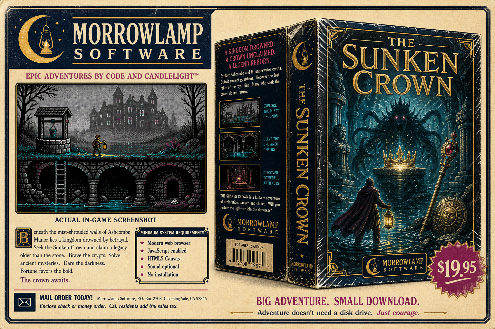

# THE SUNKEN CROWN

> **This is the original 2026 release, kept as it was. The game has moved on.**
>
> **[Play The Sunken Crown: Remastered](https://tweakyourpc.github.io/morrowlamp/remastered.html)**,
> free in your browser, with rendered rooms, a live lantern, three narrators, new rooms and puzzles,
> and an ending film. It is made with the Morrowlamp engine, and its source, along with this classic
> edition's, now lives in **[tweakyourpc/morrowlamp](https://github.com/tweakyourpc/morrowlamp)**.
> This repository is archived and no longer updated.



A point-and-click adventure RPG in the spirit of classic 1980s adventure games, built from scratch in plain JavaScript. No frameworks, no build step, no dependencies, and **no runtime image or audio assets**: every scene is drawn pixel by pixel in code against the 16-colour EGA palette, and every note of music is synthesized at runtime. The provisional fictional publisher mark is Morrowlamp Software; the `marketing/` folder contains separate retro retail concepts for later branding work, not game content.

An original story with original prose. Your grandmother left you Ashcombe, a manor that has been ignoring the weather for three hundred years, and swore its well led to a kingdom that sank into a hill. She was not wrong.

## How to run

There is no install step.

- **Serve the folder:** run `python3 -m http.server 8000` (or `python -m http.server 8000` on systems where Python is named `python`), then open `http://localhost:8000`. If port 8000 is already in use, choose any unused port such as 8001-8010 and use that number in both places. On Windows, `py -m http.server 8000` is also supported.
- Opening `index.html` from `file://` also works, though some browsers restrict `localStorage` there, which disables saving.

## How to play

The interface is a classic verb-driven icon bar. Pick a verb, then click the picture.

| Verb | Key | What it does |
| --- | --- | --- |
| **Walk** | `1` | Move there. Click a doorway or stairway to change rooms. |
| **Look** | `2` | Examine anything. Also earns Lore the first time you study something. |
| **Hand** | `3` | Context-sensitive: take, open, close, push. |
| **Talk** | `4` | Speak to whatever is listening. |
| **Attack** | `5` | Rarely the answer. Occasionally the only answer. |

`Tab` or right-click cycles verbs. Hovering names whatever is under the cursor.

**Using items:** click an item in the *Carrying* panel to lift it onto the cursor, then click what to use it on, including another inventory item. That is how the lens reads the note and the oil feeds the lamp. `Esc` or right-click puts it back.

## The RPG layer

Choose a **Delver**, **Scholar**, or **Prowler** at the start. They differ in starting stats, not in what they are allowed to do.

Five stats, Strength, Agility, Vitality, Lore, Luck, **rise by being used**, Quest for Glory style, so the character sheet ends up a record of how you played. Fighting builds Strength, dodging builds Agility, studying things builds Lore.

**Skill checks only ever help.** Nothing in the RPG layer can gate a puzzle or lock you out of the ending; stats change how comfortably you get there, never whether you can.

Combat is turn-based: Attack, Defend, **Raise light**, or Flee. Light is a weapon against the thing that lives in the dark, and raising an unlit lantern means lighting it first, which also solves the problem that summoned the creature.

## Light and the dark

The lantern burns oil, but only in rooms that are actually dark. It warns you twice before it dies. The jar of lamp oil in the cellar refills it, and the sunstone down the well is a light that never goes out, the reliable insurance policy.

If the dark catches you without a light, something in it will take an interest.

## Goal

Six pieces of regalia. Secure them all in the glass cabinet in the Entrance Hall. Bring a light, mind the echoes, and take your grandmother's warning about the lamp oil literally.

## Running the tests

```sh
node test/playthrough.js    # engine: full winning run, deaths, riddle, undo, save/load, parser
node test/scenes.js         # scene data: hotspots, exits, walkable floors, entry points
node test/ui-title.probe.js # text-mode title-screen flow against a stub DOM
```

`test/scenes.js` is the one that matters most for the graphical build: it cross-checks all 18 hand-authored scenes against `world.js`, that every room has a painter, every hotspot names a real object, every walk-to point lands on walkable floor, every passable exit has a clickable zone, and every gated exit names the same flag the engine actually checks.

**Scene coverage audit.** Scene painters can leave regions unpainted, which shows up as black bands. To check, paste this in the browser console, it repaints every scene over a non-palette sentinel colour and reports any pixel the artwork missed:

```js
const c = Object.assign(document.createElement('canvas'), { width: 320, height: 200 });
const gg = Z.gfx.create(c), holes = {};
for (const id in Z.scenes.list) {
  gg.ctx.fillStyle = '#ff00ff'; gg.ctx.fillRect(0, 0, 320, 200);
  Z.scenes.list[id].paint(gg, {});
  const d = gg.ctx.getImageData(0, 0, 320, 200).data;
  let n = 0;
  for (let i = 0; i < d.length; i += 4) if (d[i] === 255 && d[i+1] === 0 && d[i+2] === 255) n++;
  if (n) holes[id] = n;
}
console.log(Object.keys(holes).length ? holes : 'all scenes fully painted');
```

## Text mode

The original parser version is still here and still fully playable at **`text.html`** (there is a button for it in the top bar). Both front ends drive the same `engine.js`, so the puzzles, scoring, flags and save format are identical.

## Files

```
index.html            — the point-and-click shell
text.html             — the original text-adventure shell
css/publisher.css    — point-and-click interface
css/style.css         — text-mode terminal themes

js/world.js           — rooms, objects, prose            (shared)
js/engine.js          — puzzles, scoring, darkness, win  (shared, pure logic)
js/save.js            — localStorage save/load           (shared)
js/audio.js           — synthesized sound effects        (shared)

js/gfx.js             — EGA palette, Bayer dithering, drawing primitives
js/sprites.js         — parametric actor, monsters, item icons
js/scenes.js          — 18 scene painters + click data
js/rpg.js             — stats, XP, levelling, combat
js/music.js           — multi-channel sequencer and score
js/publisher.js       — point-and-click controller

js/parser.js          — verb/noun recognition            (text mode)
js/ui.js              — terminal, map, overlays          (text mode)

marketing/morrowlamp-github-marketing.png — GitHub-only Morrowlamp marketing asset

test/playthrough.js   — engine integration tests
test/scenes.js        — scene data integrity
test/ui-title.probe.js— text-mode DOM probe
```

Everything under `js/` runs unbundled in load order; `world.js`, `engine.js` and `rpg.js` have no DOM dependency and run under Node for the tests.

The title-screen hero graphic is generated at runtime by `drawTitleHero()` in `js/publisher.js`; it is intentionally not stored as an image file.

## Credits

AI orchestration author: [@tweakyourpc](https://github.com/tweakyourpc)
